<!-- ============================================================
     PROFILE README  —  pavannithin224-abcd
     Hero card generated by gh-ascii (github.com/crafter-station/gh-ascii):
     a neofetch-style ASCII card — face portrait + LIVE GitHub stats.
     dark_mode.svg / light_mode.svg switch with the viewer's theme.
     Daily refresh keeps the stats current (.github/workflows/refresh-card.yml).
     ============================================================ -->

<!-- Card carries its own dark background, so it's used in both GitHub themes. -->


<br/>

<div align="center">


<p>
  <a href="https://github.com/pavannithin224-abcd"></a>
  <a href="https://pavan-d.pages.dev"></a>
  <a href="https://www.linkedin.com/in/pavan-d-96aab62a8"></a>
  <a href="mailto:pavan.d12233@gmail.com"></a>
</p>

</div>

## 🦊 About

```text
Engineering student. I build deep-learning systems that find and localize
faults in VLSI circuits — real tools, tested on real data, not demos.

Flagship: Faultiva / CircuitSage — hybrid VLSI fault intelligence.
Find the broken gate in a chip from its output alone, CPU-only, ~0.5 ms/query,
with pre-registered contracts and a full audit trail.

Target: a 2027 VLSI / silicon internship. Everything here advances that.
Portfolio: https://pavan-d.pages.dev
```

## 🛠️ Tech Stack

**🔬 Silicon** — _where the faults live_
<br/>


**🧠 Machine** — _where the inference lives_
<br/>

<br/>


**⚙️ Systems** — _where it ships_
<br/>

<br/>


**☁️ Cloud & DevOps** — _where it runs_
<br/>

<br/>


## 🚀 Projects

<!-- Silicon / VLSI / device-ML work leads; tools & apps follow. -->
<table>
<tr>
<td width="50%">

<h4><a href="https://github.com/pavannithin224-abcd/faultiva">🦊 faultiva</a></h4>
<p>


</p>

**Find the broken gate in a chip from its output alone.** Windows app or
4.7 MB Python package — VLSI fault detection & localization, CPU-only, ~0.5 ms/query.
`vlsi` `machine-learning` `verilator` `yosys` `fault-localization`

</td>
<td width="50%">

<h4><a href="https://github.com/pavannithin224-abcd/circuitsage-vlsi-fault-detection-v2">🔬 circuitsage-vlsi-fault-detection-v2</a></h4>
<p>


</p>

**Behaviour-signature VLSI fault localization.** Method, pre-registered
contracts, audit trail. Six falsified formulations, one impossibility proof,
a structural bound. Study branch of CircuitSage. `python` `systemverilog`

</td>
</tr>
<tr>
<td width="50%">

<h4><a href="https://github.com/pavannithin224-abcd/circuitsage-hmac-fault-detection">🔐 circuitsage-hmac-fault-detection</a></h4>
<p>


</p>

**Graph-aware OpenTitan HMAC SA0/SA1 fault-detection** research prototype.
Applies the CircuitSage approach to a real crypto block. `python` `systemverilog`

</td>
<td width="50%">

<h4><a href="https://github.com/pavannithin224-abcd/endee-vlsi-fault-localizer">🧭 endee-vlsi-fault-localizer</a></h4>
<p>


</p>

**Noise-tolerant VLSI fault localization** on the Endee vector database —
retrieves nearest fault behaviours so diagnosis survives response noise that
exact dictionary lookup can't. Benchmarked on ISCAS-85 (c432/c880).
`vlsi` `fault-localization` `vector-db` `iscas-85`

</td>
</tr>
<tr>
<td width="50%">

<h4><a href="https://github.com/pavannithin224-abcd/IVForge">⚡ IVForge</a></h4>
<p>


</p>

**Simulation-efficient CMOS transistor characterization.** Reproducible PyTorch
research with SPICE-generated data, held-out geometry / operating-condition
evaluation, and adaptive sampling. `pytorch` `spice` `cmos` `device-modeling`

</td>
<td width="50%">

<h4><a href="https://github.com/pavannithin224-abcd/TinySPICE">🔌 TinySPICE</a></h4>
<p>


</p>

**Budget-aware, reliability-driven LLM agent** for reproducible MOSFET
characterization (ngspice + SKY130). Pre-registered experiments, honest
negative results. `llm-agent` `ngspice` `sky130` `mosfet`

</td>
</tr>
<tr>
<td width="50%">

<h4><a href="https://github.com/pavannithin224-abcd/wispviz">🎵 wispviz</a></h4>
<p>


</p>

**Tiny transparent audio visualiser for Windows.** 11 animations, Screen mode,
song panel. One ~180 KB exe, no dependencies, starts with Windows. `c++` `win32` `wasapi` `fft`

</td>
<td width="50%">

<h4><a href="https://github.com/pavannithin224-abcd/Online-voting-system-">🗳️ Online-voting-system</a></h4>
<p>


</p>

**Online Voting System** — web-based voting application with a Python
backend and an HTML interface. `python` `html`

</td>
</tr>
<tr>
<td width="50%">

<h4><a href="https://github.com/pavannithin224-abcd/Disaster-Response-Resource-Allocator---SAHAYAK">🆘 SAHAYAK</a></h4>
<p>


</p>

**SAHAYAK** — disaster-response resource allocator. Matches limited relief
resources to needs under constraints. `python`

</td>
<td width="50%">
</td>
</tr>
</table>

## 📊 GitHub Stats

<div align="center">


<br/><br/>

<!-- Contribution heatmap (reliable host). The old line-graph service was returning HTTP 402 / quota-exceeded. -->


</div>
