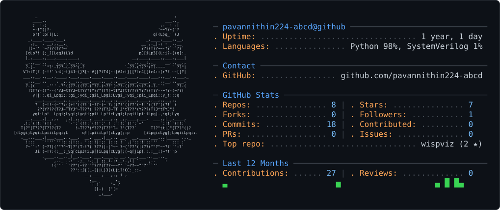

<!-- ============================================================
     PROFILE README  —  pavannithin224-abcd
     Hero card generated by gh-ascii (github.com/crafter-station/gh-ascii):
     a neofetch-style ASCII card — fox portrait + LIVE GitHub stats.
     dark_mode.svg / light_mode.svg switch with the viewer's theme.
     Daily refresh keeps the stats current (.github/workflows/refresh-card.yml).
     ============================================================ -->

<!-- Fox carries its own dark background, so the dark card is used in both GitHub themes. -->


<br/>

<div align="center">


<p>
  <a href="https://github.com/pavannithin224-abcd"></a>
  <a href="https://www.linkedin.com/in/pavan-d-96aab62a8"></a>
  <a href="mailto:pavan.d12233@gmail.com"></a>
</p>

</div>

## 🦊 About

```text
Engineering student. I build deep-learning systems that find and localize
faults in VLSI circuits — real tools, tested on real data, not demos.

Flagship: Faultiva / CircuitSage — hybrid VLSI fault intelligence.
Find the broken gate in a chip from its output alone, CPU-only, ~0.5 ms/query,
with pre-registered contracts and a full audit trail.

Target: a 2027 VLSI / silicon internship. Everything here advances that.
```

## 🛠️ Tech Stack

<p>
  
</p>


## 🚀 Projects

<table>
<tr>
<td width="50%">

<a href="https://github.com/pavannithin224-abcd/faultiva">
  
</a>

**Find the broken gate in a chip from its output alone.** Windows app or
4.7 MB Python package — VLSI fault detection & localization, CPU-only, ~0.5 ms/query.
`vlsi` `machine-learning` `verilator` `yosys` `fault-localization`

</td>
<td width="50%">

<a href="https://github.com/pavannithin224-abcd/circuitsage-vlsi-fault-detection-v2">
  
</a>

**Behaviour-signature VLSI fault localization.** Method, pre-registered
contracts, audit trail. Six falsified formulations, one impossibility proof,
a structural bound. Study branch of CircuitSage. `python` `systemverilog`

</td>
</tr>
<tr>
<td width="50%">

<a href="https://github.com/pavannithin224-abcd/circuitsage-hmac-fault-detection">
  
</a>

**Graph-aware OpenTitan HMAC SA0/SA1 fault-detection** research prototype.
Applies the CircuitSage approach to a real crypto block. `python` `systemverilog`

</td>
<td width="50%">

<a href="https://github.com/pavannithin224-abcd/siliconLM">
  
</a>

**siliconLM** — language-model experiments for silicon / hardware workflows.
`python` `jupyter`

</td>
</tr>
<tr>
<td width="50%">

<a href="https://github.com/pavannithin224-abcd/wispviz">
  
</a>

**Tiny transparent audio visualiser for Windows.** 11 animations, Screen mode,
song panel. One ~180 KB exe, no dependencies, starts with Windows. `c++` `win32` `wasapi` `fft`

</td>
<td width="50%">

<a href="https://github.com/pavannithin224-abcd/Disaster-Response-Resource-Allocator---SAHAYAK">
  
</a>

**SAHAYAK** — disaster-response resource allocator. Matches limited relief
resources to needs under constraints. `python`

</td>
</tr>
</table>

<sub>Also: <a href="https://github.com/pavannithin224-abcd/Online-voting-system-">Online-voting-system</a> — a Python voting-system build.</sub>

## 📊 GitHub Stats

<div align="center">


</div>
